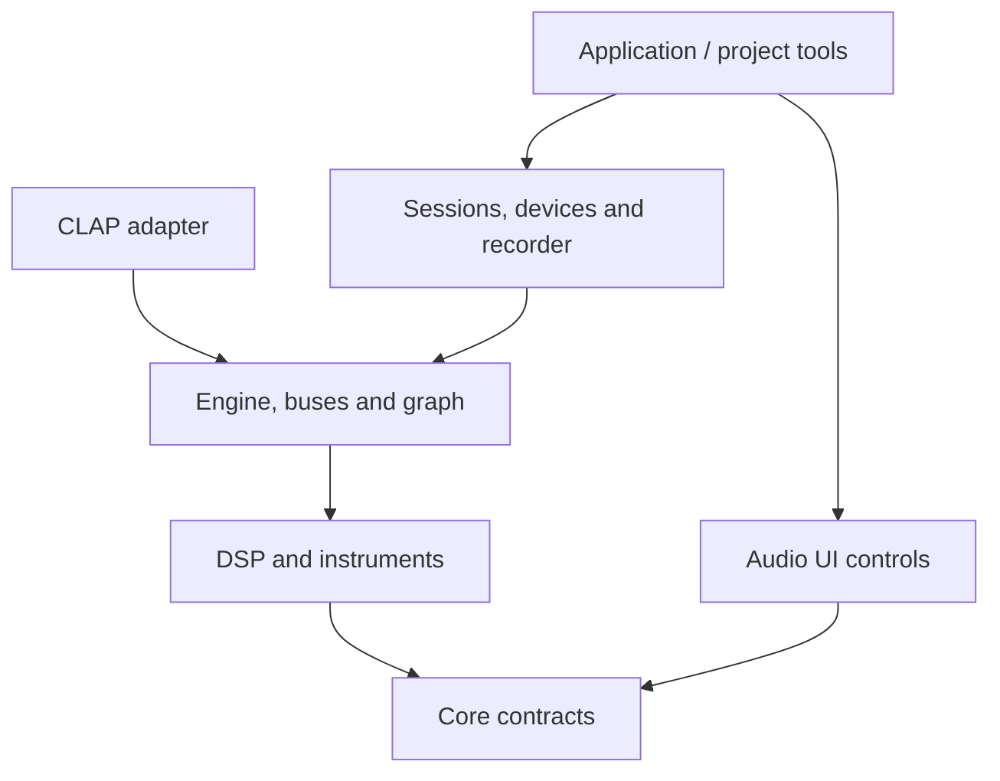

# Architecture

## Boundaries

Portable processing contracts sit at the center. Device hosts, applications and the CLAP adapter own processors and translate their environments into those contracts. UI code changes shared scalar parameters or sends bounded events; it never locks an active processor.

MIDI parsing produces core events. JSON state and WAV I/O run on control/worker threads. The facade's `native`, `ui` and `midi-input` features keep platform stacks optional. `soniclaw-clap` is a separate adapter dependency, so standalone apps need not link a plug-in ABI.

## Engine and automation

`ProcessSpec` defines sample rate, maximum block length and the in-place channel layout. `AudioBuffer` borrows interleaved f32 storage; no block ownership crosses processor boundaries. Sources replace audio and effects modify it. `prepare` allocates; `process` reuses storage.

`Engine` validates preparation, frame alignment and ordered MIDI events. `process_automated` also validates all parameter IDs/ranges before changing a block. It splits at automation offsets, applies all same-frame changes before render, translates MIDI offsets and supplies the segment's transport position. Processing stores scratch events allocated at preparation. Each MIDI/automation list is limited to 1024 events when automation splitting is used; native CLAP input is always bounded to 1024 incoming events.

Scalar parameter reads/stores use relaxed atomics because they carry no dependent data. Same-frame engine events are coherent to processors because the group is applied by the rendering thread. Arbitrary multi-parameter UI writes are still independent scalar changes. Gain smooths over 10 ms; exact event scheduling does not remove that intentional ramp. The legacy `LowPass` still updates per segment. `AutomatedEffect` provides per-frame smoothing for its live filter and other controls.

`render` and `render_automated` are allocating offline helpers. `suspend` clears processor state; suspended blocks return silence and do not advance transport. Resume permits future processing. Incoming events while suspended are not queued for later replay.

## Separate buses

`BusLayout` explicitly identifies main-input, output and sidechain channel counts; `BusSpec` adds timing/block limits. `BusEngine` validates lengths and calls a `BusProcessor`. `InPlaceBus` adapts an `Engine` to independent input/output layouts, including mono duplication and averaging. It rejects unused sidechains. `SidechainDucker` is a real linked-channel compressor using a separate detector bus; detector audio never becomes output.

The in-place graph and native duplex host remain single-layout/stereo, respectively. Bus processing is a distinct API for applications/custom hosts, not a claim that every adapter supports arbitrary layouts. The CLAP adapter exports fixed stereo main ports and an optional separate stereo sidechain key. Arbitrary CLAP layouts are still unsupported.

## Routing and latency

Graph topology is edited while stopped. Preparation rejects cycles, computes a topological order and each path's declared processor latency, allocates buffers, and inserts compensation delays on shorter fan-in and output paths. External input contributes latency zero. Each delay line is capped at 262,144 frames; unsupported graphs fail preparation.

An echo effect's musical delay is not processing latency and remains uncompensated. Processors must report actual algorithmic latency for alignment to be correct. Topology/latency changes require preparation. There are no feedback edges, live graph replacement or parallel worker scheduling yet.

## Sessions and recording

The output callback owns the engine; the input callback owns a frame producer. A prefilled adaptive reader bridges them without locks or allocations. Stream errors and device availability are polled on the control thread. Reconnection creates a fresh engine from an application factory and mutes monitoring.

Recording uses a separate fixed-packet queue. The worker owns its WAV writer. Packet frame positions preserve timeline length under overflow. Start/stop are control-thread barriers around queue generation and in-flight capture; they never open or finalize a file in the callback. See [SESSIONS.md](SESSIONS.md).

## CLAP and state

`PluginInstance` binds persistent parameter names to stable FNV-1a numeric IDs, rejects collisions, and owns the engine lifecycle. `soniclaw-clap` translates planar host buffers into prepared interleaved scratch storage before processing, including in-place buffers and input constant masks. It translates MIDI and parameter events and reports fixed ports/latency/tail.

The mutable runtime is exclusively accessed under CLAP's lifecycle/thread rules. Shared metadata/parameter callbacks do not borrow it. Sequence-stamped atomic state staging lets a complete validated parameter snapshot apply at a render boundary. Schema-1 presets are parameter snapshots. Opt-in schema-2 project state persists asset references, sample maps, rack settings and routing; reconstruction happens while deactivated. Voices and delay history are not persisted. See [projects](PROJECTS.md). See [CLAP.md](CLAP.md) for the narrow unsafe boundary and unsupported capabilities.

## Dependencies

Pinned integration versions use documented APIs; they are not claims of being the latest release. `Cargo.lock` records this workspace's resolution.

- [CPAL 0.15.3](https://docs.rs/cpal/0.15.3/cpal/): devices and streams.
- [eframe/egui 0.36.1](https://docs.rs/eframe/0.36.1/eframe/): windowing and controls.
- [rtrb 0.3.2](https://docs.rs/rtrb/0.3.2/rtrb/): bounded SPSC queues.
- [midir 0.10.1](https://docs.rs/midir/0.10.1/midir/): native MIDI.
- [hound 3.5.1](https://docs.rs/hound/3.5.1/hound/): WAV files.
- [clap-sys 0.5.0](https://docs.rs/clap-sys/0.5.0/clap_sys/): CLAP ABI types.
- [allocation-counter 0.8.1](https://docs.rs/allocation-counter/0.8.1/allocation_counter/): test-only allocation measurement.

## v0.3 native editor and format boundary

soniclaw-editor owns GUI-thread window handles and a bounded edit producer. Soniclaw UI controls use optimistic local values until sequence acknowledgements confirm the audio consumer applied them; host automation then becomes authoritative again. This avoids stale UI feedback while the host output event queue is full. The CLAP consumer emits complete begin/value/end adjustment gestures across callbacks without locks. Native callbacks are destroyed with the editor before the host pointer can expire.

The VST3/AUv2 wrappers statically reference the same Rust CLAP factory, state and processing contracts. Their C++ code stays outside the portable Rust crates. VST3 is validated on Linux; AUv2 and other native targets require their target-machine checks.
